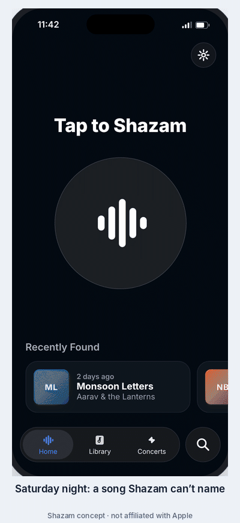

# We'll Keep Looking: a Shazam concept

A clickable iPhone prototype from my Shazam product teardown.

**Problem:** when Shazam can't find a song, the user hits a dead end. "No Result", one button (Try Again), and nothing is saved, so the song is lost.
**Concept:** *We'll Keep Looking.* While a song plays, Shazam has seconds to search. Afterwards it has days. If it heard music but couldn't name it, it keeps the sound thumbprint (codes, never audio) and searches harder for 30 days: other speeds, every country's catalogue and new releases. When it finds a likely match, the user confirms it by hearing the exact part they caught. Noise, talking and accidental taps are never saved. The miss screen also offers a lyrics search right away.
**North Star:** songs caught per week. Key input: rescue rate. Guardrail: rescue accuracy, the share of suggested matches users confirm (target 90+ in 100).

## What's inside
- `index.html`: the phone on its own. Choose what's playing (a song, or people talking), tap anything, and use "Skip 3 days" to see a missed song come back for you to confirm. "Start over" resets.
- `walkthrough.html`: the same phone with a 9-step guide comparing today's app with the concept at each step.

Both pages are self-contained, with no build step. Unchanged screens (Home, Listening, Expanding search, No Result, the Library ••• menu) are recreated from the real app on an iPhone 16, Oct 2026.

## Run locally
Open `index.html` in a browser.

## Deploy
On Vercel: Add New → Project → import this repo → Framework preset "Other", no build command → Deploy.

---
Concept work for a product teardown by Pritesh Kabra. Not affiliated with Apple or Shazam. Songs and artists are invented.
